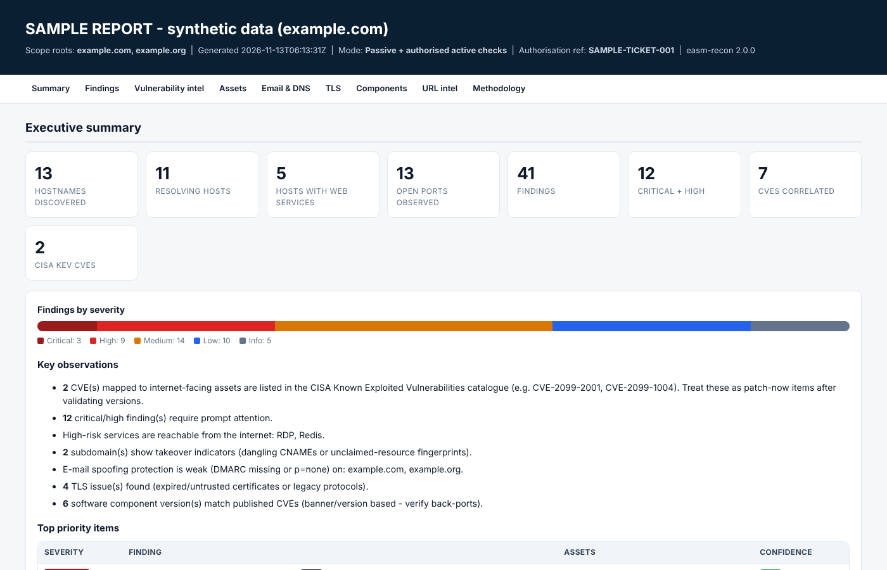
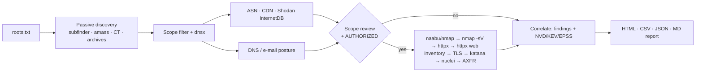
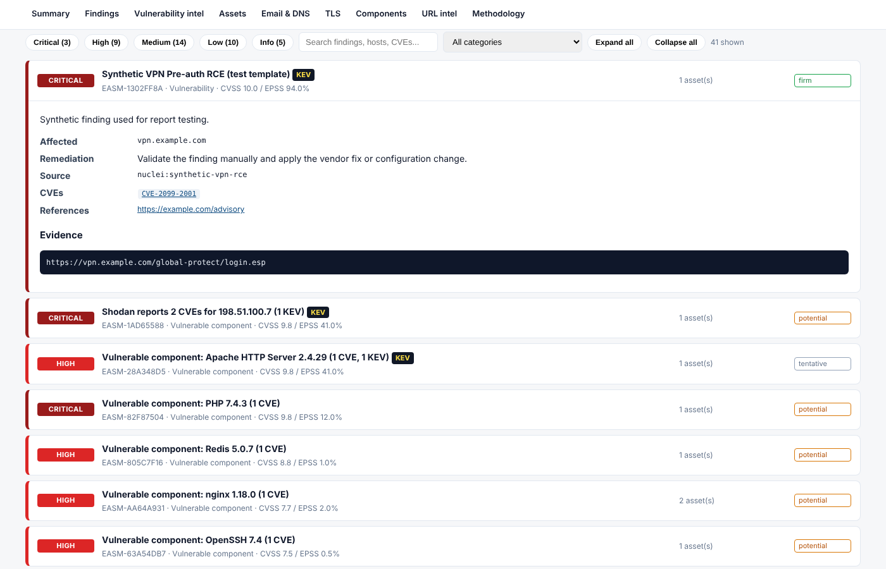

# easm-recon

**External Attack Surface Management (EASM) & vulnerability recon for authorised assessments.**

easm-recon chains best-of-breed open-source recon tools into one workflow with scope gating. It discovers an organisation's internet-facing assets and checks their DNS, e-mail and TLS posture. It then fingerprints exposed services and correlates them with **NVD CVEs, CISA KEV and FIRST EPSS**. The output is a single **offline HTML report** plus CSV/JSON exports.



> Open [`docs/sample-report.html`](docs/sample-report.html) in a browser to explore an example report. It is built from synthetic data (example.com, RFC 5737 IPs, fictional `CVE-2099-*` IDs).

---

## ⚠️ Legal & safety

This tool is built for **authorised** security testing, such as your own organisation, a contracted VAPT engagement or a bug-bounty scope.

* **Passive phases** (discovery, DNS, CT logs, archives, InternetDB, CVE intel) talk only to public data sources and resolvers.
* **Active phases** (port scan, service detection, HTTP/TLS probing, crawling, nuclei, AXFR) **never run automatically**. They need one of the following:
  * an **interactive scope review** (you edit the staged allowlist, give an authorisation/ticket reference and type `AUTHORIZED`), or
  * a **pre-approved allowlist** with `--allowlist FILE --auth-ref REF` for scheduled or CI runs.
* Every active target is checked to be **under the supplied root domains**. CDN/edge IPs get only ports 80/443.
* nuclei runs **non-intrusive** templates only. It excludes `dos, fuzz, intrusive, bruteforce, default-login, osint, headless` and makes no out-of-band (interactsh) calls.
* All traffic is rate-limited and every rate can be configured. The authorisation reference goes into the report, and evidence is SHA-256 hashed.

Scanning systems without permission may be illegal. You are responsible for staying inside your written scope.

---

## Features

| Area | What it does |
|---|---|
| **Subdomain discovery** | subfinder (all sources), amass (passive), assetfinder, findomain, crt.sh, Cert Spotter, web-archive hostnames. Optional DNS brute force (`--dns-brute`) and alterx permutations |
| **Resolution & enrichment** | dnsx (with a dig fallback), Team Cymru ASN/org, CDN/WAF detection, wildcard DNS detection, internal IPs leaking into public DNS |
| **Passive vuln intel** | Shodan **InternetDB** (free, no key, no packets to target): open ports, CPEs and CVEs per IP. CDN IPs are skipped |
| **DNS & e-mail posture** | SPF (`+all`/`?all`, missing `all`, >10 lookups, duplicates), DMARC (missing, `p=none`, `pct`, `sp`, `rua`), DKIM (36 common selectors), MTA-STS, TLS-RPT, BIMI, DNSSEC, CAA, AXFR (active) |
| **Subdomain takeover** | Dangling-CNAME detection for 25 services, plus HTTP fingerprint confirmation (active) and nuclei takeover templates |
| **Historical URLs** | gau/waybackurls (plus katana crawl in active mode). Classifies secrets in query strings, backups/configs/keys, API docs, admin paths, redirect/file params and JS |
| **Ports & services** | naabu (CDN-aware) or nmap fallback, then `nmap -sV` per IP on the open ports only |
| **Web** | httpx: status, title, tech (Wappalyzer), server, CDN, favicon hash, response headers |
| **Web asset inventory** | Low-rate httpx pass (2 req/s, 2 threads) over the approved hosts: status, title, tech, IP, CNAME and redirect. Saved as `findings/web-assets.csv` and shown in the report's **Web inventory** tab |
| **Web hygiene** | HTTP without an HTTPS redirect, HSTS, CSP, clickjacking, nosniff, version banners, X-Powered-By, cookie flags, CORS with credentials, exposed login/admin panels |
| **TLS** | Expired or expiring certificates, self-signed, untrusted chain, hostname mismatch, TLS 1.0/1.1 enabled, TLS 1.3 support |
| **Template scanning** | nuclei in two passes: web (`http,ssl`) and network services (`tcp,ssl,javascript`) |
| **CVE mapping** | Versions from nmap, httpx tech, headers and Shodan CPEs are mapped to NVD CPEs with **local version-range matching**. Results are enriched with **CISA KEV** (ransomware flag) and **EPSS**, and prioritised as KEV → CVSS → EPSS |
| **Risky exposure** | 40+ ports that should not be public (RDP, SMB, DBs, Redis, Docker API, Kubelet, etc.) |
| **Reporting** | Self-contained HTML with no CDN (works air-gapped): executive summary, filterable findings, CVE table, asset inventory with risk scores, e-mail/DNS matrix, TLS, components and URL intel. Also exports `report/{findings,assets,cves}.csv`, `findings.json`, `summary.md` and `findings/web-assets.csv` |
| **Continuous EASM** | `--compare PREVIOUS_RUN` lists new and gone hosts and new and resolved findings. `--report-only` re-analyses an old run, for example after adding an NVD key |

### Confidence model

Every finding carries a confidence level so analysts can triage quickly:

* `confirmed`: directly observed (open port, expired certificate, AXFR response)
* `firm`: matched by a specific detection (nuclei template, takeover fingerprint)
* `potential`: inferred from version banners or third-party passive data, and needs validation
* `tentative`: heuristic only (distro back-port suspected, login page detected by its title)

Version-based CVE matches on Ubuntu/Debian/RHEL banners are automatically downgraded. Those distributions back-port fixes without changing version strings.

---

## Workflow



---

## Installation

Tested on Kali Linux. Should work on any Debian/Ubuntu with Python 3.9+ and Go 1.21+.

```bash
git clone https://github.com/khandakerashik/easm-recon.git
cd easm-recon
./install.sh            # apt packages + ProjectDiscovery tools + nuclei templates
./install.sh --check    # show what is installed
```

Only `python3` is strictly required, and every other tool is optional. Missing tools are skipped with a warning, and the tool inventory in the report records what ran.

**Recommended:**

```bash
export NVD_API_KEY=xxxxxxxx   # free: https://nvd.nist.gov/developers/request-an-api-key (10× faster CVE mapping)
# subfinder API keys (Shodan, Censys, SecurityTrails, VirusTotal, Chaos, ...):
#   ~/.config/subfinder/provider-config.yaml
```

> On Kali, `httpx` may point to the Python HTTP client. easm-recon detects this and uses `httpx-toolkit` or ProjectDiscovery's `httpx` from `~/go/bin`.

---

## Usage

```bash
# Passive only: nothing touches the target
./easm-recon.sh --passive-only example.com

# Interactive: passive phases, then scope review, then authorised active checks
./easm-recon.sh "example.com,example.org"
./easm-recon.sh domains.txt

# Non-interactive, pre-approved scope (cron / CI)
./easm-recon.sh --allowlist approved_hosts.txt --auth-ref CHG-2026-0142 example.com

# Profiles
./easm-recon.sh --profile quick example.com     # top-100 ports, medium+ templates, no amass
./easm-recon.sh --profile deep  example.com     # all ports, info+ templates, crawl, permutations

# Broader discovery
./easm-recon.sh --dns-brute /usr/share/seclists/Discovery/DNS/subdomains-top1million-20000.txt example.com

# Continuous monitoring: diff against last week's run
./easm-recon.sh --allowlist approved.txt --auth-ref EASM-WEEKLY --compare easm_example.com_20261106T010000Z example.com

# Re-analyse / re-render an existing run (e.g. after setting NVD_API_KEY)
./easm-recon.sh --report-only easm_example.com_20261113T060000Z
```

Run `./easm-recon.sh --help` to see all options.

### Configuration

Copy `config/easm.conf.example` to `config/easm.conf`, where it is loaded automatically, or pass a file with `-c`. Settings are applied in this order: **profile → config file → CLI flags**. Main knobs:

| Variable | Default | Purpose |
|---|---|---|
| `TOP_PORTS` | 1000 | `100`, `1000` or `full` |
| `NAABU_RATE` / `NMAP_MAX_RATE` | 150 / 100 | packets per second |
| `HTTPX_RATE` | 5 | HTTP requests per second |
| `ENABLE_WEB_INVENTORY` / `WEB_INVENTORY_RATE` / `WEB_INVENTORY_THREADS` | 1 / 2 / 2 | httpx web asset inventory (`--no-web-inventory` to skip) |
| `NUCLEI_RATE` / `NUCLEI_SEVERITY` | 10 / low+ | template scanning |
| `NUCLEI_EXCLUDE_TAGS` | dos,fuzz,intrusive,… | safety exclusions |
| `DNSX_RATE` | 50 | DNS queries per second (public resolvers) |
| `ENABLE_CRAWL`, `ENABLE_PERMUTATIONS`, `ENABLE_INTERNETDB`, `ENABLE_AXFR` | 0,0,1,1 | feature toggles |

---

## Output

```
easm_example.com_<UTC>/
├── roots.txt  candidates.txt
├── passive/        per-source discovery results (subfinder.txt, crtsh.txt, ...)
├── dns/            dnsx.jsonl, root-dns.json (SPF/DMARC/DKIM/...), whois_*.txt
├── enrich/         hosts.json, asn.json, internetdb.json
├── urls/           archived-urls.txt
├── authorized/     authorized_hosts.txt   (validated active scope), web-assets.csv (raw httpx CSV)
├── scan/ ports/    naabu.jsonl, services/*.xml (nmap -sV)
├── http/ tls/      httpx.jsonl, tls.json
├── crawl/ vuln/    katana.txt, nuclei.jsonl
├── analysis/       assets.json, findings.json, cves.json, components.json, urls.json
├── findings/       web-assets.csv         (web asset inventory, copied from authorized/)
├── report/         index.html, findings.csv, assets.csv, cves.csv, summary.md,
│                   SHA256SUMS.txt, tool-inventory.txt, run-meta.txt
└── logs/           run.log + per-tool stderr
```



### Web asset inventory

After the main HTTP probe, the active phase runs a gentle httpx pass over the validated allowlist. It is equivalent to:

```bash
httpx-toolkit -l authorized/authorized_hosts.txt \
  -sc -title -td -ip -cname -location \
  -rl 2 -t 2 -timeout 10 \
  -csv -o authorized/web-assets.csv
```

The report step copies the CSV verbatim to `findings/web-assets.csv`. It also renders it in the HTML report (**Web inventory** tab: filterable, sortable) and adds a table to `summary.md`. `--report-only` re-publishes it for older runs that have `authorized/web-assets.csv`.

```bash
head -n 10 easm_example.com_<UTC>/findings/web-assets.csv
```

ProjectDiscovery `httpx` is used when `httpx-toolkit` is absent. The parser accepts both current and older httpx CSV headers.

---

## How CVE mapping works

1. **Collect components.** Product and version come from `nmap -sV` (including CPEs), httpx tech-detect (`Nginx:1.18.0`), `Server`/`X-Powered-By` headers and Shodan InternetDB CPEs.
2. **Normalise.** [`data/cpe-map.json`](data/cpe-map.json) maps ~55 common products (web servers, SSH, PHP, CMSs, JS libraries, databases, mail servers, etc.) to NVD `vendor:product` pairs.
3. **Query NVD once per product.** Each query uses `virtualMatchString=cpe:2.3:a:vendor:product:*…` and is cached for 7 days in `~/.cache/easm-recon`.
4. **Match locally.** Each CVE's `cpeMatch` version ranges (`versionStart/EndIncluding/Excluding`) are evaluated with a version comparator that understands `1.0.2k`, `8.2p1` and `-rc1`.
5. **Enrich.** CISA KEV (daily cache) and FIRST EPSS (batched) are added. CVEs from nuclei and InternetDB also get CVSS details from NVD.
6. **Report.** Results appear as one finding per component/version (all affected assets listed) and as a global CVE table ranked by `KEV → CVSS → EPSS`.

Without an API key, NVD allows 5 requests per 30 seconds. The tool throttles itself, and caching keeps repeat runs fast. `--offline-intel` uses the cache only.

---

## Extending

* **More products:** add entries to `data/cpe-map.json`.
* **Risky ports:** edit `data/risky-ports.json`.
* **Takeover fingerprints:** edit `data/takeover-fingerprints.json`.
* **Custom nuclei templates:** set `NUCLEI_TEMPLATES=/path/to/templates`.
* **Engine:** the Python engine (`engine/easm.py`, standard library only) can be run on its own. Use `analyze`, `report`, `dns-posture` and the other subcommands on any run directory.

## Testing

```bash
python3 tests/test_engine.py            # 54 offline tests: version ranges, scope, rules, KEV/EPSS, web inventory, XSS-safe report
shellcheck -x easm-recon.sh lib/*.sh
```

## Roadmap

- [ ] Cloud storage enumeration (S3/Azure Blob/GCS) for in-scope naming patterns
- [ ] Screenshots (gowitness) embedded in the report
- [ ] JavaScript secret/endpoint extraction
- [ ] End-of-life (EOL) software detection
- [ ] PDF export and SARIF output

## Changes from v1 (`osint_recon.sh`)

v2 is a rewrite of the original single-file workflow. It keeps the scope-confirmation model (the editor review plus the typed `AUTHORIZED` phrase) and adds the following:

* Broader discovery: assetfinder, findomain, Cert Spotter, archive hostnames, brute force and permutations.
* The staged allowlist is now built from **all resolving in-scope hosts**, not subfinder output only. Unresolved hosts are listed as commented lines.
* A mandatory authorisation reference, plus a non-interactive `--allowlist/--auth-ref` mode.
* Port and service scanning, TLS posture checks, nuclei, takeover checks and e-mail/DNS posture rules.
* CVE/KEV/EPSS correlation, a risk-scored asset inventory and an HTML report.

## License

MIT. See [LICENSE](LICENSE).
